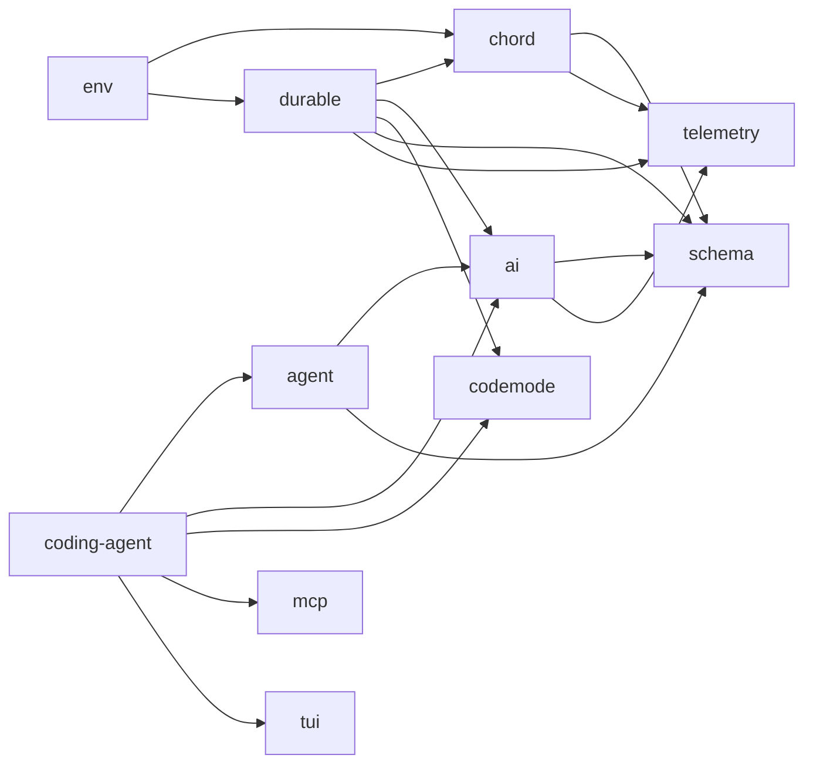

# 实践课 2：组织建仓与源码分析

- 姓名：王晨
- 身份：小组组员
- 小组组织：`applerere`
- 小组仓库：<https://github.com/applerere/pi-hunnu-2026>
- 分支：`main`
- 分析提交：`c3cc91632d0a1950fb122605b190233f2aa0006e`
- 分析日期：2026-11-16

> 说明：仓库由组长从教师课程仓库 `hunnuOpenSourceSoftware2026/pi-hunnu-2026` fork 到小组组织 `applerere` 下，本文分析基于该 fork 的 `main` 分支与上述提交。

## 1. 小组仓库与成员

小组仓库已建立在 GitHub 组织 `applerere` 下，仓库为公开仓库，默认分支为 `main`，与教师课程仓库保持同步。组员已加入组织，具备后续共同开发所需的读写权限。


## 2. 本地仓库信息

```text
本地路径：C:\Users\LEGION\pi-hunnu-2026
当前分支：main
HEAD：c3cc91632d0a1950fb122605b190233f2aa0006e
origin：https://github.com/applerere/pi-hunnu-2026.git
upstream：https://github.com/hunnuOpenSourceSoftware2026/pi-hunnu-2026.git
工作区状态：clean
```


实际 clone 地址（文本形式）：

```text
https://github.com/applerere/pi-hunnu-2026.git
```

## 3. 根目录构建配置

根目录 `package.json` 将项目声明为 npm workspaces 单体仓库，`engines.node` 要求 `>=22.19.0`（`package.json:69`）。根目录的 `build` 脚本（`package.json:15`）没有并行调用所有 workspace，而是用连续的 `cd ... && npm run build` 明确控制顺序，依次构建 11 个模块：

```text
telemetry → schema → chord → tui → codemode → mcp → ai → durable → env → agent → coding-agent
```

- 绝大多数模块执行 `tsc -p tsconfig.build.json`，把 JavaScript 与 `.d.ts` 类型声明输出到各自的 `dist/`；
- `ai` 先运行 `generate-models`（`node catalog/generate.ts --strict`）生成供应商与模型目录数据，再执行 `build:offline`：校验模型数据 → 编译 → 清理并复制 `src/providers/data` 到 `dist/providers`；
- `coding-agent` 先 `build:unbundled`（编译 + 设置 `dist/cli.js`、`dist/rpc-entry.js` 可执行位 + 复制主题 JSON、交互界面 PNG、导出 HTML 的模板与 vendor 资源），再用 esbuild 打包到 `dist/bundle`（含代码分割）；
- `env` 除 TypeScript 构建外，守护进程另有 `build:daemon`（`cargo build`），不在根 `build` 链路中；
- `tui` 另有 `build:native:win32` / `build:native:linux` / `build:native:darwin` 三个平台原生构建脚本，同样不在根 `build` 链路中。

另外，`packages/evals` 有自己的 `package.json`，但既没有 `build` 脚本也不在根构建顺序里，它只以 `devDependencies` 形式引用 `ai` 与 `coding-agent`，属于测试/评测辅助包。

## 4. 模块分析表

表中“直接内部依赖”只统计各模块 `package.json` 中声明的 `@earendil-works/*` 依赖，不把构建顺序相邻关系当作依赖。

| 模块 | 主要功能 | 构建动作与产物 | 直接内部依赖 | 证据 |
|---|---|---|---|---|
| `telemetry` | 与厂商无关的遥测契约与类型化 schema 工具 | `tsc -p tsconfig.build.json`，输出 `dist/`（JS + `.d.ts`） | 无 | `packages/telemetry/package.json:31` |
| `schema` | 不使用 `eval` 的 JSON Schema 校验，支持 2020-12 与 draft-7，编译为闭包 | `tsc -p tsconfig.build.json`，输出 `dist/` | 无 | `packages/schema/package.json:29` |
| `chord` | 跨进程对象运行时：契约、文档、存储、链接、插件热重载、HTTP、Worker 与多种客户端 | `tsc -p tsconfig.build.json`，输出 `dist/` | `schema`、`telemetry` | `packages/chord/package.json:151`、`:172` |
| `tui` | 终端用户界面库，用差分渲染提升文本界面效率 | `tsc -p tsconfig.build.json`，输出 `dist/`；另有各平台原生构建脚本 | 无 | `packages/tui/package.json:9` |
| `codemode` | 在受限沙箱中执行 JavaScript，唯一能力是调用注入的工具 | `tsc -p tsconfig.build.json`，输出 `dist/` | 无 | `packages/codemode/package.json:46` |
| `mcp` | 独立的 Model Context Protocol 客户端，供 Pi 或其他程序连接 MCP 服务 | `tsc -p tsconfig.build.json`，输出 `dist/` | 无 | `packages/mcp/package.json:34` |
| `ai` | 统一多供应商 LLM API，负责模型发现与供应商配置 | `generate-models` → `check:model-data` → `tsc` → 复制 `src/providers/data` 到 `dist/providers` | `schema`、`telemetry` | `packages/ai/package.json:76`、`:81` |
| `durable` | 持久化对话、任务与文档运行时 | `tsc -p tsconfig.build.json`，输出 `dist/` | `chord`、`ai`、`codemode`、`schema`、`telemetry` | `packages/durable/package.json:133`、`:166` |
| `env` | 通过 SSH 部署小型守护进程，为 Pi Durable 提供远程执行环境 | `tsc -p tsconfig.build.json`，输出 `dist/`；`build:daemon` 用 Cargo 构建 | `chord`、`durable` | `packages/env/package.json:26`、`:47` |
| `agent` | 通用 Agent 核心：传输抽象、状态管理、工具调用与附件支持 | `tsc -p tsconfig.build.json`，输出 `dist/` | `ai`、`schema` | `packages/agent/package.json:21`、`:25` |
| `coding-agent` | 编码 Agent CLI：读文件、执行命令、编辑、写入工具与会话管理 | `tsc` → 设置可执行入口并复制主题/图片/HTML 资源 → esbuild 打包到 `dist/bundle` | `agent`、`ai`、`codemode`、`mcp`、`tui` | `packages/coding-agent/package.json:33`、`:43` |

## 5. 模块依赖图

箭头方向为“使用者 → 被依赖模块”。可编辑源文件为 [`module-dependencies.mmd`](module-dependencies.mmd)。



层级划分依据：按“被依赖深度”自下而上分三层。

- **基础层**：`telemetry`、`schema`，不依赖任何内部模块，被上层广泛复用；
- **能力层**：`chord`、`ai`、`durable`、`env`、`tui`、`codemode`、`mcp`，其中 `chord`/`ai` 依赖基础层，`durable` 进一步组合 `chord`/`ai`/`codemode`，`env` 又建立在 `durable` 之上；
- **应用层**：`agent` 汇聚 AI 与 schema 能力，`coding-agent` 作为最终 CLI，把 `agent`、`ai`、`codemode`、`mcp`、`tui` 组装成可运行程序。

## 6. 思考题

### 6.1 根目录和子模块如何配置构建？实际执行了什么？

根目录通过 npm workspaces 管理多个包，但 `build` 没有简单地并行调用所有 workspace，而是用连续的 `cd ... && npm run build` 明确控制顺序（`package.json:15`）。

子模块的 `build` 大多读取各自的 `tsconfig.build.json`，调用 TypeScript 编译器，把 JavaScript 与 `.d.ts` 类型声明生成到 `dist/`。其中三个模块有额外动作：

- `ai`：先 `generate-models` 从外部模型目录生成供应商数据，再校验数据、编译，并把 `src/providers/data` 复制进 `dist/providers`；
- `coding-agent`：先编译并设置 CLI/RPC 入口的可执行位、复制主题、图片与导出 HTML 资源，最后用 esbuild 把入口打包到 `dist/bundle`；
- `env`：TypeScript 部分同上，另有独立的 `build:daemon` 用 Cargo 构建守护进程。

### 6.2 构建顺序与依赖关系有什么关系？相邻构建是否必然存在依赖？

构建顺序总体遵守“被依赖模块先构建、使用者后构建”：`schema`、`telemetry` 排在最前，`ai` 在 `agent` 之前，`agent` 又在 `coding-agent` 之前。

但相邻构建不必然存在依赖，可以用实际依赖声明反证：

- `chord` 之后是 `tui`，而 `tui` 的 `dependencies` 里没有内部模块，二者无直接依赖；
- `tui` 之后是 `codemode`，`codemode` 同样没有内部依赖；
- `mcp` 之后是 `ai`，但 `ai` 并不依赖 `mcp`（`mcp` 只是被 `coding-agent` 使用）；
- `env` 之后是 `agent`，`agent` 只依赖 `ai` 与 `schema`，与 `env` 无关。

因此依赖关系必须以各模块 `package.json` 的 `dependencies` 为证据，不能只凭脚本先后顺序判断；构建顺序只是一个满足依赖的拓扑线性化，这个线性化里允许夹入互不相关的模块。

### 6.3 给出一条至少跨越 3 个模块的依赖路径

```text
coding-agent → agent → ai → schema
```

`coding-agent` 直接依赖 `agent`，`agent` 直接依赖 `ai`，`ai` 又直接依赖 `schema`，共 3 条依赖边、涉及 4 个模块。

分工说明：

- `schema` 提供 JSON Schema 校验能力，是纯函数式的底层工具；
- `ai` 用 `schema` 校验模型与供应商配置，对外提供统一的多供应商 LLM 调用接口；
- `agent` 在 `ai` 之上实现会话状态、工具调用与传输抽象，屏蔽具体模型差异；
- `coding-agent` 在 `agent` 之上补齐 CLI、TUI 交互、MCP 客户端与 `codemode` 沙箱工具，形成最终可执行的编码助手。

另一条同样满足条件的路径是 `env → durable → chord → schema`。

## 7. 实践结论

本项目是以 npm workspaces 组织的 TypeScript 单体仓库：根脚本用串行 `cd` 固定构建顺序，子模块以 `tsc -p tsconfig.build.json` 为主，`ai` 与 `coding-agent` 因数据生成与资源打包而更复杂。

从依赖看，`schema`、`telemetry` 是最底层、被复用最多的模块；`chord`、`ai`、`durable`、`env` 构成能力层；`agent` 与 `coding-agent` 在最上层完成组装。构建顺序与依赖关系大体一致但不完全等价，读 `package.json` 的依赖声明才是判断模块关系的可靠依据。

## 附：提交清单

- 个人报告仓库：`<你的个人仓库地址>`
- 小组代码仓库：<https://github.com/applerere/pi-hunnu-2026>
- 实际 clone 地址：`https://github.com/applerere/pi-hunnu-2026.git`
- 截图：`screenshots/S1-group-repository.png`、`screenshots/S2-organization-members.png`、`screenshots/S3-local-git.png`
